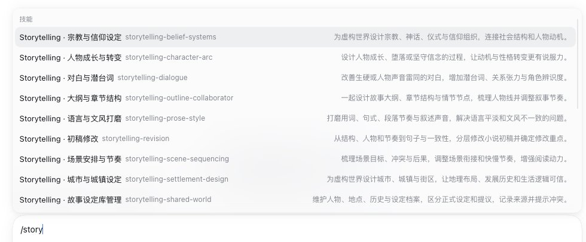

# dsh-skill-display-enrichment

给 DSH 的 / 技能菜单补上 Codex 已有的本地化显示名和简述（示例为中文）。

插件名不含 zh，是因为显示语言来自 agents/openai.yaml；中文只是当前的使用
场景，任何语言都可以用同一套 metadata。

历史：v0.2.0 之前叫 skill-display-zh；v0.4.0 起叫 skill-display-enrichment，
因为“zh”把显示语言写进了插件名，而实际语言由 metadata 决定。

## 它做什么

Codex 会读取每个 skill 的 agents/openai.yaml：

    interface:
      display_name: "Storytelling · 对白与潜台词"
      short_description: "改善生硬或人物声音雷同的对白……"

DSH 目前只读 SKILL.md 的 name 和 description，所以菜单里只显示
storytelling-dialogue 和英文描述。

这个插件在 Web 客户端里找到 ui-skill 注册的 / 菜单源，保留它的筛选和
选择逻辑，只给候选项补上：

- label：本地化显示名（示例为中文）
- description：本地化简述
- name：仍然是真实 skill 名，因此选中后插入的还是 /storytelling-dialogue

菜单会显示成：

    Storytelling · 对白与潜台词   storytelling-dialogue   改善生硬或人物声音雷同的对白……

## 安装

这个包通过 GitHub 仓库分发，不发布到 npm：

    git clone https://github.com/YinXiaoyu-1998/YXY_DSH_PLUGIN.git
    cd YXY_DSH_PLUGIN
    REPO="$PWD"
    DSH="dsh"   # 或 dsh CLI 的完整路径

    # 在目标 profile 里安装本地包（示例用 probe profile）
    "$DSH" plugin --profile probe-skill-display-enrichment add "$REPO/plugins/skill-display-enrichment"

    # 0.2.1-rc.2 实测 dsh plugin add 会同时写入 dependencies 和 bundles
    # 若你的版本只写 dependencies，手动把 dsh-skill-display-enrichment 加进 bundles

    # 启动 profile
    "$DSH" --profile probe-skill-display-enrichment web

在 DSH Desktop 里，建议通过“设置 → 插件”安装本地目录，或把包加入
~/.dsh/profiles/desktop/package.json 的 dsh.profile.bundles，然后重启。

## 开启 / 关闭

- 在“设置 → 插件”里启用或停用 skill-display-enrichment。
- 停用后客户端模块不会加载，菜单恢复原始 name / description。
- 也可以从 profile 的 dsh.profile.bundles 中移除本包。

## 更新显示文案

新增或改名 skill 后，重新生成嵌入的元数据：

    cd plugins/skill-display-enrichment
    node scripts/sync-metadata.mjs

然后重启 profile（或让客户端 HMR 重新加载）。

## 诊断与版本日志

插件加载时会在 Web 控制台打印一行版本日志，例如：

    [skill-display-enrichment] v0.4.0 loaded (build 2026-10-20T05:05:10.207Z, hash 4439d703fabd); DSH 0.2.1-rc.2; 32 labels
    [skill-display-enrichment] patched /skill menu source; 32 labels available

状态有六种：

- starting：apply 已开始，尚未找到菜单源
- waiting：等待 ui-skill 注册菜单源（最多 10 秒）
- active：已 patch，本地化显示名生效
- native：检测到 DSH 已经原生支持 displayName/shortDescription，插件自动停用
- inactive：菜单源不存在或形状不兼容，插件没有生效
- disposed：插件被卸载

在浏览器控制台可以随时查看完整自检：

    window.__DSH_SKILL_DISPLAY_ENRICHMENT__.report()

它会返回插件版本、构建时间、metadata hash、DSH 版本、状态、是否检测到
原生支持、菜单源是否存在、candidates 类型、覆盖的 skill 数量等。

如果未来 DSH 官方加了 displayName，插件第一次拉到非空 catalog 时会检测到
并自动 restore 原始 candidates，不再覆盖官方行为。

## 升级是否会被覆盖

不会。这个包在你的 GitHub 仓库/本地 clone 里，不在 app.asar 里；
DSH 升级替换应用包，不会删除用户 profile 的插件目录或本地依赖。

但它是通过 patch ui-skill 的浏览器端 candidates() 实现的。如果未来 DSH
升级改掉这个菜单源的形状（例如不再叫 skill、不再有 candidates，或菜单
不再支持 label），插件会失效并在控制台打印一条警告，菜单回退英文。
届时需要按新的菜单 API 更新本插件；这属于 DSH 改动读取方式，不是普通
升级覆盖。

如果 DSH 官方支持了 displayName/shortDescription，插件会自动进入 native
状态，不再 patch。

## 相关文档

- [DSH Ideas Discussion #10375](https://github.com/deepseek-ai/deepseek-harness/discussions/10375)
- [给 DSH 的功能建议（英文）](docs/dsh-feature-proposal.md)
- [给 DSH 的功能建议（中文）](docs/dsh-feature-proposal.zh.md)
- [GitHub Discussion 草稿](docs/dsh-discussion-post.md)
- [兼容性自检与版本日志](docs/compatibility-diagnostics.md)
- [核心参考 patch](docs/dsh-patch.diff)（基于 DSH master 687f282e，仅生产文件，未跑仓库测试）

## 测试

    node scripts/sync-metadata.mjs
    node test/patch.test.mjs
